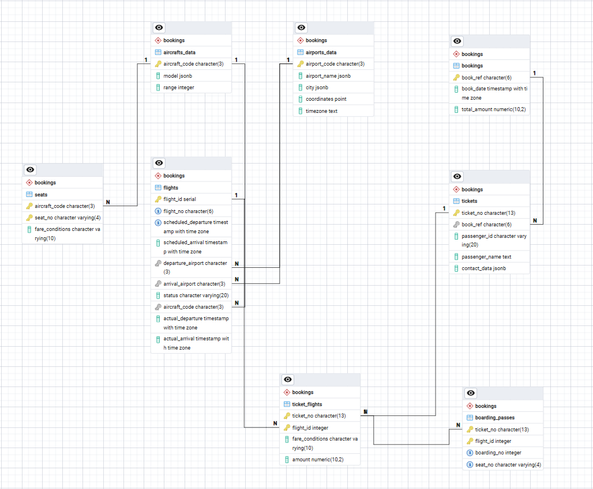
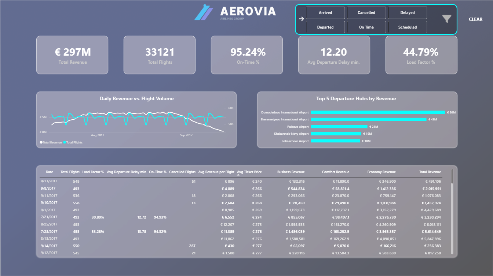
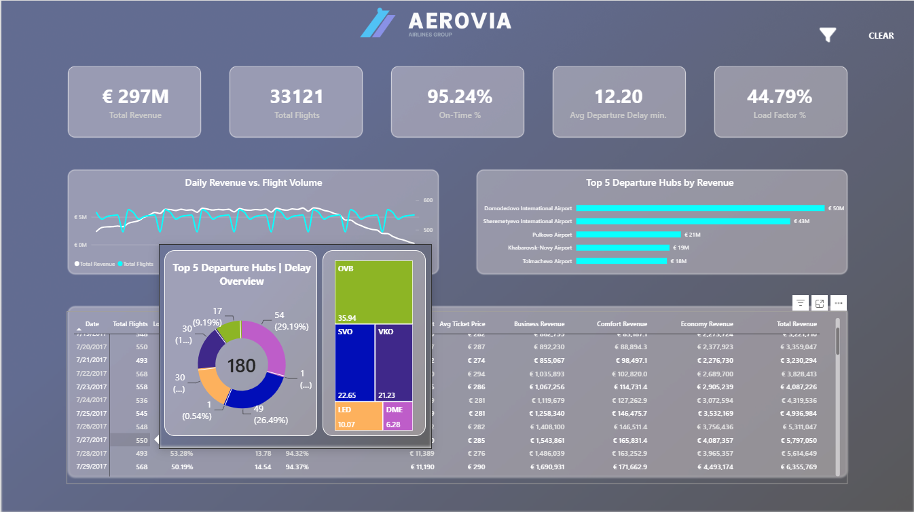

# Flight-Database-Project
A complete analytics project built on a relational airline booking database. The project includes SQL analysis, ERD diagram, documentation, and Power BI dashboard.

#

### Project Structure
* **ERD diagram** (Entity Relationship Diagram)
* **Table descriptions** & Data Dictionary
* **SQL scripts** (Views, window functions, and data quality checks)
* **Power BI dashboard** (`.pbix` with Figma UI integration)
* **Documentation**
#

## ERD Diagram

It shows relationships between:
bookings
tickets
ticket_flights
flights
airports_data
aircrafts_data
seats
boarding_passes
#

## Table Relationships (Technical Overview)

- **bookings → tickets (1:N)**  
  One booking can contain multiple tickets.

- **tickets → ticket_flights (1:N)**  
  One ticket can be used for multiple flights (connections).

- **flights → ticket_flights (1:N)**  
  One flight has multiple tickets.

- **flights → airports_data (1:N)**  
  Each flight has one departure airport and one arrival airport.

- **flights → aircrafts_data (1:N)**  
  One aircraft can operate multiple flights.

- **aircrafts_data → seats (1:N)**  
  One aircraft has multiple seats.

- **tickets → boarding_passes (1:N)**  
  One ticket can have multiple boarding passes.

- **flights → boarding_passes (1:N)**  
  One flight has multiple passengers.
#

## SQL Analysis
SQL scripts are located in /sql/.
01_data_quality_checks.sql
02_analysis_queries.sql
#

## Power BI Dashboard
The Power BI file dashboard.pbix is located in /powerbi/.
Dashboard includes:
revenue by flight
seat occupancy
flight delays
route popularity
aircraft utilization
### Interactive Features & UI

**Filter Panel (Bookmarks & Selection):**

**Dynamic Drilldown Tooltip:**

#

## Documentation
Located in /docs/:

